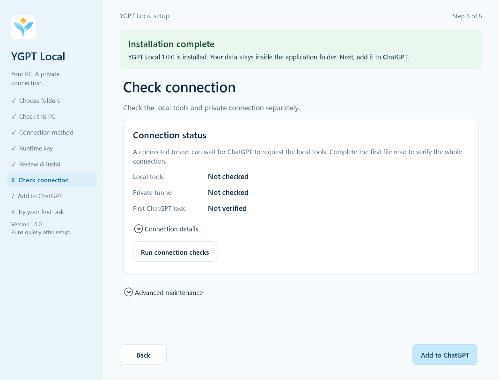

# YGPT Local 1.0.0

[中文说明](RELEASE_1.0.0_ZH.md)

Stable release, October 23, 2026. Download Setup, Update or Portable from [GitHub Releases](https://github.com/jclllycf/ygpt-local/releases/tag/v1.0.0). The existing repository remains private.

## What changed

- A cleaner light-blue sprout mark, including its lower stem, with the original shape and golden sun preserved. Full-color application PNGs ship at 256, 512 and 1024 pixels; Windows icons include seven sizes from 16 to 256 pixels. Only the dedicated plugin-upload PNG is compressed below 10 KB.
- A simpler English-only Windows guide: clear step names, descriptive next actions, inline folder browsers, copy confirmations and Segoe UI Variable typography with a Segoe UI fallback. Appearance, cleanup and advanced options expand when needed. Local tools, the private tunnel and the first ChatGPT task have separate status rows.
- A pale-blue approval button with dark text, a working embedded icon and a refreshed resource address. Previous addresses continue to serve the current component.
- The rc.18 field repairs: data inside the chosen application folder, contained update staging and rollback files, automatic isolated-browser cleanup, and separate daily-browser relays for each profile and chat.
- English README, setup guide, upgrade guide and release notes, with separate Chinese documentation.
- Prominent installation, verification and update outcomes, visible operation progress and a clear recovery action after failure. Completed updates switch the main action to **Close updater**. The uninstall result lists removed files, modified or locked files left behind and intentionally retained private data, with **Open retained folder** and **Copy details** actions. A private `data/uninstall-report.json` records the result.

## Install or update

| Download | Use |
| --- | --- |
| `YGPTLocal-Setup-1.0.0-win-x64.exe` | First installation |
| `YGPTLocal-Update-1.0.0-win-x64.exe` | Update in place |
| `ygpt-local-portable-1.0.0-win-x64.zip` | Extracted application payload |
| `SHA256SUMS.txt` | Verify the three downloads |

The installers are unsigned. Updates preserve settings, encrypted credentials, connection identity, snapshots, state keys and extension pairing. No new ChatGPT plugin is required.

```text
Your chosen YGPTLocal folder/
  YGPTLocal.exe
  runtime/  runtimes/  engine/  service/  extension/  assets/
  data/       Settings, encrypted state, snapshots, caches, temporary browser data
  .updates/   Update staging, rollback members, local recovery records
```

Windows shortcuts and the logon task are OS registration entries. Product-owned data and update files stay under the application folder.

If an unpacked extension from rc.17 or earlier is still loaded, click Reload once in each browser profile's extension manager. Keep its saved pairing token. The new extension version is 1.0.19. A profile without the extension still needs initial installation and pairing.

## Verification and limits

Windows regression, real Edge CSP/image checks, native WPF rendering, native compilation, the source publication scan and package checks are recorded in [verification](../evidence/stable-1.0.0-verification.json). The primary approval button has a measured minimum text contrast of 7.33:1 in light and dark modes. Native screenshots use the actual compiled window with disposable fixture data; they do not install or provision a connection.

Final Windows regression: **119 checks, 114 passed, 0 failed, 5 platform skips**. The uninstall fixture covers unchanged, changed, locked, unknown and private files, retry behavior and refusal of unsafe manifest paths.



[Uninstall result preview — fixture data](images/uninstall-result-1.0.0.png)

Prior field migration and browser evidence is preserved in [rc.18 verification](../evidence/rc18-verification.json). Real ChatGPT rendering and physical human decisions, all signed-in browser workflows, Windows sign-in recovery and a clean-Windows installation still require owner acceptance. Controlled fixtures do not establish those results. Private runtime state, credentials, logs and recovery data are excluded from publication.

The master at `assets/brand/ygpt-glyph-master.png` was edited with built-in imagegen. Edit instruction: lighten only the lower blue stem and arms to fresh sky blue, approximately `#94ddfa` to `#65bef2`, while preserving the silhouette, white division, golden sun, proportions and transparency. The repository's icon script exports the sizes.
