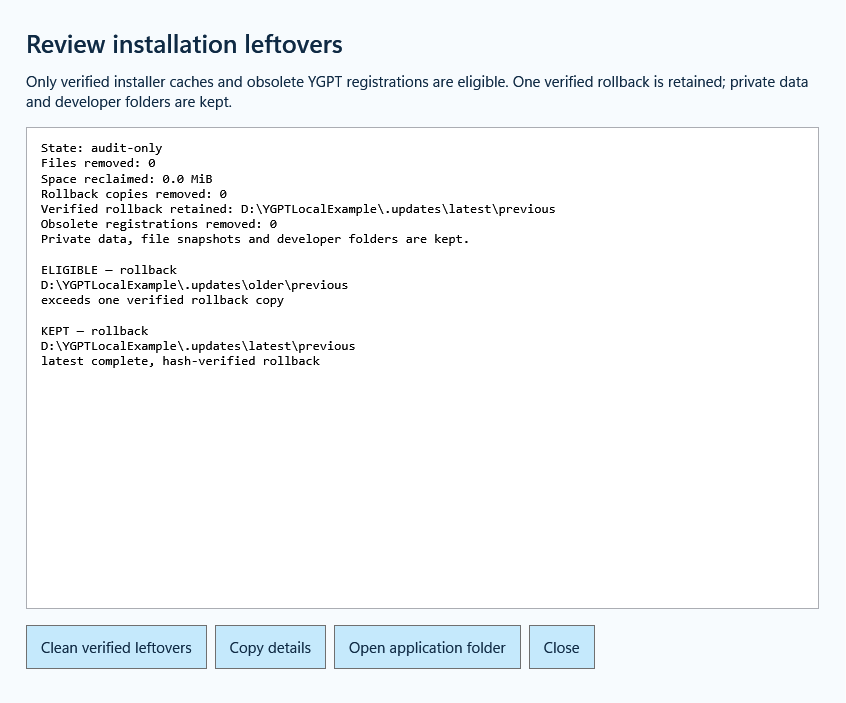

# YGPT Local 1.0.1 — installation cleanup

[中文说明](RELEASE_1.0.1_ZH.md) · [Setup](SETUP_GUIDE.md) · [Previous release](RELEASE_1.0.0.md)

This patch adds a complete installation-leftover workflow to the English Windows guide and updater. Use `YGPTLocal-Update-1.0.1-win-x64.exe` for an existing installation, or Setup for a new installation. The installers are unsigned; verify downloads using `SHA256SUMS.txt`.

## What is cleaned

- Recognize current `.updates/<transaction>/previous` directories as well as earlier owned backup locations. The previous cleanup code only searched the retired `.previous-*` layout.
- After verifying the current payload and a healthy connection, retain the newest complete, hash-verified rollback and remove surplus verified program copies. Modified, linked, shared, unknown or referenced files remain with a reason.
- Remove redundant installer downloads inside `.updates/releases` only when their recorded SHA-256 matches and no running process or startup reference needs them. If no rollback passes verification, retain caches for repair.
- Audit current-user YGPT uninstall entries. Back up an obsolete entry before removing it. The current registration, another live installation, unknown command formats and unavailable drives remain untouched. No old uninstall command is run. An uninstall request naming an obsolete data directory is rejected before stopping the current connection or deleting files.
- An earlier Complete download receipt no longer suppresses cleanup for a newly registered updater. The updater offers an explicit checkbox for removing its exact external download after verification and window exit. Downloads is never swept.

## Clear results and limits

Settings → **Advanced maintenance → Review installation leftovers** shows eligible and retained paths, reasons, reclaimed space, obsolete registrations and the retained rollback. **Clean verified leftovers** runs the same guarded cleanup. Results are stored privately in `data/installation-housekeeping-receipt.json`; registration backups stay inside `.updates/registry-backups`.

The existing Watchdog runs the check after the connection is healthy and retries pending work. A cache fingerprint avoids repeatedly hashing unchanged rollback payloads. No additional background service is installed.

Private configuration, encrypted credentials, state databases, file snapshots, migration records, recovery records, working folders and development repositories are preserved. Developer `dist` and test directories are reported separately when investigating this host; the consumer installer does not delete them. In particular, a Git common directory is a live development dependency, even if its folder name contains “recovery”.

Deletion results distinguish removed, retained, deferred and review-needed items. A healthy local connection is not a real ChatGPT human-approval test. See [verification](../evidence/housekeeping-1.0.1-verification.json) for Windows fixture and field evidence.

The light-blue HD icons, English setup improvements and prominent installation/update/verification/uninstall outcomes from 1.0.0 remain included. Browser behavior and pairing are preserved. An extension still loaded from rc.17 or earlier needs one Reload per browser profile.

