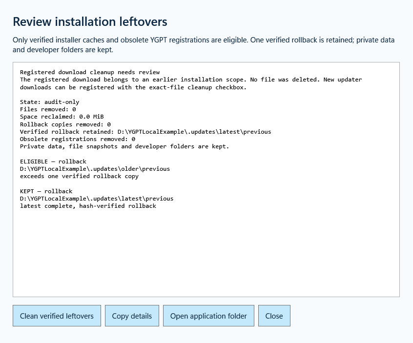

# YGPT Local 1.0.3 — integrated Windows release

[中文说明](RELEASE_1.0.3_ZH.md) · [Setup](SETUP_GUIDE.md) · [Cleanup details](RELEASE_1.0.2.md)

This release combines the installation-cleanup improvements with concurrent fixes from the GitHub main branch. It preserves both sets of changes rather than replacing the newer remote work.

- Keep one complete, verified rollback and automatically prune surplus verified program copies and contained installer caches after the current installation is healthy.
- Back up obsolete uninstall registrations before removing them. Reject obsolete uninstall data scopes before stopping the current connection.
- Run download cleanup independently of cache maintenance. Signed download records from a pre-migration scope produce an explicit review-required result without rebinding consent or deleting files. Registering a current updater with its exact-file checkbox resumes download cleanup.
- Show removed, retained, deferred and review-needed items, reclaimed space and the retained rollback in the English cleanup window. Preserve credentials, private state, snapshots, migration/recovery records and development repositories.
- Preserve installed dependency versions and registry tarball metadata when changing the product version.
- Scope Windows CI to the intended branches/tags, cancel obsolete branch builds and authenticate publisher-metadata checks. Distinguish metadata failures, missing runtime assets and checksum mismatches.
- Ignore unrelated malformed WMI process paths while refusing ambiguous paths referring to this installation. Improve physical-path, private-ACL and transient UIA fixture handling.

The English setup, separate Chinese documentation, light-blue HD icons, browser lifecycle fixes and clearer installation/verification/update/uninstall feedback remain included. Use Update for an existing installation, Setup for a new installation, and verify `SHA256SUMS.txt`. Installers are unsigned. An extension still loaded from rc.17 or earlier needs one Reload per browser profile.

The owner's installed 1.0.2 passed file, identity, ACL and connection checks, including automatic cleanup. **Installation of 1.0.3 on the owner's machine is deferred at their request.** Its source, tests and release artifacts are verified separately in the [verification record](../evidence/housekeeping-1.0.3-verification.json). Real ChatGPT human approval, every signed-in browser workflow, Windows sign-in recovery and clean-Windows acceptance remain unverified.

