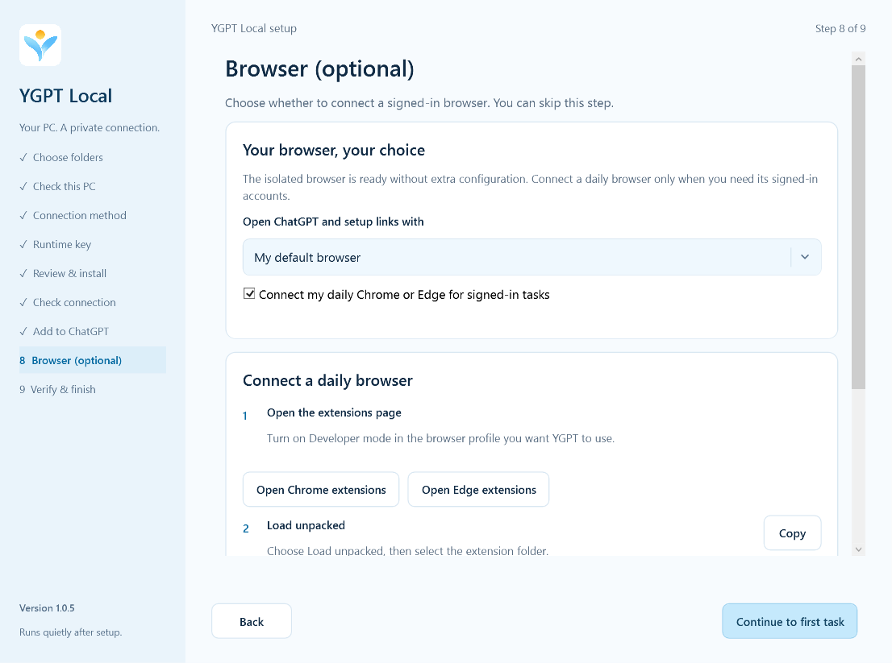

# YGPT Local 1.0.5 — 修复 Chrome 配置目录导致的启动失败

[English release notes](RELEASE_1.0.5.md) · [安装指南](SETUP_GUIDE.zh-CN.md) · [验证记录](../evidence/startup-1.0.5-verification.json)

本次修复安装后可能出现的断连：Tunnel 保持连接，但本地引擎因内部 Chrome `Profile 1` 缓存权限被误判而无法启动，工具调用随后超时。旧检查只识别 `Default` 缓存，现在也识别数字编号的 `Profile N`。

例外仍限定在 YGPT 内部 Chrome 目录、当前 Windows 所有者、已知的 Chrome 网络服务能力 SID 及缓存/存储路径。其他 SID、凭据目录、伪造配置名及非预期链接仍会被拒绝；无需删除浏览器配置或放宽权限。

浏览器下拉框改为与向导一致的浅蓝底色、圆角边框、清晰箭头和菜单选中状态，并保留原生选择、键盘操作和明显的焦点提示。

日常浏览器的 YGPT 分组维持活动状态。Chrome 将分组仅收进书签栏需要先关闭分组，会关闭 Agent 正在使用的标签；因此本次保留现有工作方式，不强制关闭或隐藏活动分组。

已有安装请运行 `YGPTLocal-Update-1.0.5-win-x64.exe`，保留原安装目录、私人数据及 Tunnel 身份，下载后核对 `SHA256SUMS.txt`。安装包尚未签名。自动回归、本机恢复证据与真实 ChatGPT 使用证据分别记录；不代表干净虚拟机、重启和所有账户均已验收。

[欢迎反馈](https://github.com/jclllycf/ygpt-local/issues/new)，请提供版本与复现步骤，不要提交密钥、配对 token 或私人内容。
