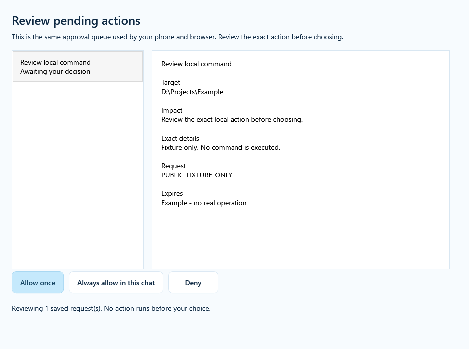

# YGPT Local 1.0.6 — Cross-device approval recovery

[中文说明](RELEASE_1.0.6_ZH.md) · [Setup guide](SETUP_GUIDE.md) · [Verification](../evidence/mobile-1.0.6-verification.json)

An approval could remain stuck on a phone while its completed card later appeared after a desktop decision. YGPT previously asked the model to keep waiting inside the same response. Some hosts may defer component mounting until that response ends. This release removes that lifecycle conflict; the precise Android client cause remains unconfirmed.

## One saved decision across devices

Show the card, then let the response finish. The displayed component checks the saved request while visible and receives the decision made on another device. After a choice it sends a short continuation message so ChatGPT can retrieve the original result. The server deduplicates automatic messages across cards and reloads. An uncertain message can be retried with **Resume chat**; this retries the message, never the operation.

The new resource URI is `ui://ygpt/approval/strip-v6-cross-device.html`. Old addresses remain compatible. Delayed metadata, the standard MCP Apps bridge and `window.openai` are supported; bridge fallback follows an explicit unsupported-method response, never an ambiguous timeout. Buttons retain exact-request capability checks, expiration, conversation scope, denial and replay protection. Approval capabilities remain in component-only metadata, and follow-up messages contain no capability tokens.

## When the app does not show the card

Open the same conversation on the web, or open **Settings → Verify & finish → Advanced maintenance → Open approval center** on the Windows computer. The installed executable also accepts `--approvals --data-dir "<installation>\data"`. This manual window reviews the same saved requests through the existing authenticated Windows-owner pipe. It creates no public listener and never decides automatically. Keep the computer and its YGPT connection running.

The Windows center is a local fallback, not an independent phone-accessible website. Such a website would require a separate HTTPS service and authenticated user access; a private Secure MCP Tunnel does not provide that browser endpoint. If no card is available on the phone, a PC decision followed by a return to the same chat remains the supported recovery path.

## About “Opened … / CSP off”

ChatGPT draws the outer plugin container. YGPT cannot remove or restyle that shell using component CSS. This release supplies descriptive metadata and preserves hashed script/style CSP plus restrictive resource metadata. The outer badge alone does not establish whether the component's own policy is enforced. There is no promise that a release, CSS change or CSP setting will remove the host badge, and security is not weakened to hide it. Other plugins can use different host presentation; their absence of the badge does not identify its cause here.

## Updating and validation

Use `YGPTLocal-Update-1.0.6-win-x64.exe` for an existing installation and compare it with `SHA256SUMS.txt`. Keep the existing application directory, encrypted keys and Tunnel identity. Installers remain unsigned.

Tests cover pending-response yielding, old URI compatibility, delayed metadata, phone/desktop browser viewports, external decisions, durable notification deduplication, owner-pipe authentication and the compiled WPF center. These are controlled fixtures, not physical Android ChatGPT acceptance. Refresh the plugin's tool definitions when the host still advertises the old catalog; an old in-progress response may retain its earlier instructions. An existing approval must be resumed from its saved result, never recreated by repeating a risky command.

[Feedback is welcome](https://github.com/jclllycf/ygpt-local/issues/new). Include app/client versions and reproduction steps; omit keys, tokens and private contents.
