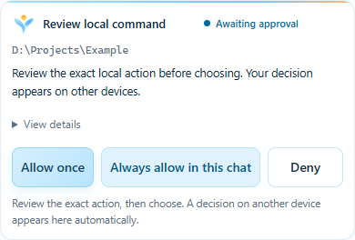

# YGPT Local 1.0.6 — 跨端授权恢复

[English release notes](RELEASE_1.0.6.md) · [安装指南](SETUP_GUIDE.zh-CN.md) · [验证记录](../evidence/mobile-1.0.6-verification.json)

手机等待时不显示授权卡片、电脑完成授权后又能显示完成卡片，说明客户端并非完全不能渲染。旧指引要求模型持续在同一回复里等待，而部分客户端可能等回复结束才挂载组件。本次消除这项生命周期冲突；Android 客户端的确切原因仍未确认。

现在先显示卡片并结束当前回复。已显示的卡片会检查同一份请求状态，跟随另一端的决定更新；决定完成后发出简短的继续消息，让 ChatGPT 读取原结果。服务端持久化去重，避免多个卡片自动重复发消息；消息结果不明确时，**Resume chat** 仅重试消息，不重跑操作。临时能力令牌不放进该消息。

组件统一使用新的版本地址，同时兼容旧地址、延迟到达的元数据、标准 MCP Apps 桥接和 `window.openai`。保留请求绑定、会话范围、到期、拒绝、防重放及严格 CSP。触屏按钮至少 44 像素高。

卡片未显示时，可在电脑网页打开同一会话，或在本机 **Settings → Verify & finish → Advanced maintenance → Open approval center** 手动打开授权中心。也可运行已安装程序并指定 `--approvals --data-dir "<安装目录>\data"`。它通过现有的 Windows 所有者认证管道操作同一份请求，不新增公网监听，不自动批准。电脑及 YGPT 连接需要保持运行。

这不是一个手机可独立访问的授权网站。独立网页还需要 HTTPS 服务和用户身份认证，OpenAI 私有 Secure MCP Tunnel 本身不提供这个网页入口。手机仍不显示时，现阶段通过电脑处理原请求，再回到同一聊天继续。

`Opened … / CSP off` 外壳由 ChatGPT 绘制，不能靠卡片 CSS 隐藏或美化。内部组件继续使用哈希脚本/样式 CSP 和受限资源元数据；外层标识本身不足以判断内部策略是否执行。没有证据保证正式发行后标识消失，也不会通过降低安全限制去隐藏它。其他插件采用的宿主呈现可能不同，不能据此确定 YGPT 标识出现的唯一原因。

已有安装运行 `YGPTLocal-Update-1.0.6-win-x64.exe`，核对 `SHA256SUMS.txt`，保留原目录、密钥与 Tunnel 身份。安装包尚未签名。回归测试覆盖浏览器双尺寸、延迟元数据、跨端状态、通知去重、认证管道和实际编译的 Windows 窗口；这些不等同于真实 Android ChatGPT 已验收。宿主仍使用旧工具目录时需刷新插件工具定义；旧回复也可能保留原指引。不要重跑已经提交的高危命令。

[欢迎反馈](https://github.com/jclllycf/ygpt-local/issues/new)，请提供客户端版本和复现步骤，不要提交密钥、token 或私人内容。
