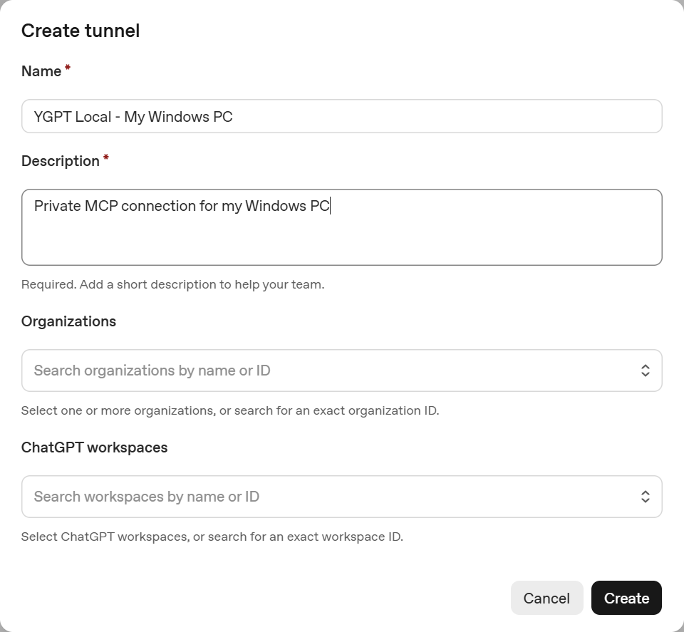

# RC3 installation / RC3 逐字段安装

This is the candidate's guide, not evidence that a new user or ChatGPT has passed acceptance. Interface wording can change. Official sources and observation limits are listed below.

## 1. Local setup / 本机设置

The wizard, Settings and status interface are English-only. There is no language switch. Pick an application directory and a separate working folder. Authorize local access before continuing. Auto-start and safe cleanup default to On and can be disabled. This follows the owner's updated UI requirement; the separate Chinese documentation remains available.

程序目录保存运行组件和按需 Settings；授权工作目录用于文件任务，不默认开放整个磁盘。不要把已有生产目录选作实验安装目录。

Secure Tunnel is recommended and selected by default. **Advanced connection methods** contains Cloudflare and local-only modes. A loopback-only installation cannot be reached by remote ChatGPT.

## 2. OpenAI Create tunnel

Open [Platform Tunnels](https://platform.openai.com/settings/organization/tunnels) using the organization that will own the runtime credential. Click **Create tunnel**.

| Current field / 字段 | What to enter / 填写内容 |
| --- | --- |
| Name | `YGPT Local - My Windows PC` — use **Copy suggested Tunnel name** in the installer instead of typing |
| Description | `Private MCP connection for my Windows PC` — use **Copy suggested Tunnel description** |
| Organizations | The intended Platform organization; not merely a ChatGPT subscription name / 运行 Key 所属 Platform 组织 |
| ChatGPT workspaces | The workspace in which the personal plugin will be installed / 实际安装个人插件的 ChatGPT 工作区 |

These four fields were inspected in the real official form on 2026-10-21. The capture uses example text and empty organization/workspace selections, contains no real Tunnel ID and does not record a creation. Click the image to enlarge it; the same capture is embedded in the Windows guide.

Create the resource in your own account, then copy the **complete** `tunnel_…` ID into **Dedicated Secure MCP Tunnel ID**. An ID is not an API key. Use a dedicated acceptance Tunnel while another production connection remains active.

Creation/editing requires organization-level **Tunnels Read + Manage**; running/selecting requires **Read + Use**, plus the appropriate associated ChatGPT workspace. Missing organization privileges are not fixed by changing a project API key to All. See [official Tunnel documentation](https://developers.openai.com/api/docs/guides/secure-mcp-tunnels).

## 3. Runtime API key / 运行 Key

Open the official [API Keys](https://platform.openai.com/api-keys) entry. If the navigation or labels differ, use the current Platform API Keys menu; do not enter credentials into third-party copies of the page.

| Field / 字段 | Guidance / 指导 |
| --- | --- |
| Owned by | **You** for personal use; Service account only when the organization intends that ownership / 个人通常选 You |
| Name | `YGPT Local Tunnel Runtime` — use **Copy suggested API key name** |
| Project | A project in the organization with the required Tunnel privileges / 对应组织内有权使用的项目 |
| Expiration | **Never expire only if offered and permitted by organization policy**; otherwise choose a permitted expiry and plan rotation / 不放宽组织策略 |
| Permissions | A dedicated minimum-scope credential with actual organization **Tunnels Read + Use**; do not assume project All grants missing organization RBAC |

The live API-key form was not successfully rendered in this development session. This table is conditional guidance; its current field variants and expiry choices remain a live-UI acceptance item. No API-key-form mock is presented as an official screenshot.

Copy the one-time secret into the Windows **masked runtime key field**, never into a chat, issue, screenshot or plugin description. The application saves it with current-user DPAPI. It does not submit model-generation requests or create API keys. A long-lived key remains usable after a leak until revoked: keep revocation and rotation available.

Saved users see **Saved credential detected** and keep it by default. Expand **Replace** only for a new value; **Test** reports actual service state. Existing ciphertext does not prove that the key is valid online.

| Result / 状态 | Next step / 下一步 |
| --- | --- |
| `RUNTIME_KEY_INVALID_OR_EXPIRED` | Inspect expiry/revocation and replace the local saved key / 核对到期或吊销，替换本机 Key |
| `TUNNEL_PERMISSION_OR_WORKSPACE_DENIED` | Check organization Read + Use, the selected Tunnel and workspace association; the status alone cannot distinguish every denial reason |
| Local ready, Tunnel not verified | Inspect outbound HTTPS/proxy and official account eligibility; do not recreate resources blindly |
| No local Broker before first handshake | The official private Tunnel may still be waiting for the host; this alone is not a restart trigger |

No system proxy/firewall changes are made. Advanced proxy input accepts HTTP(S) without embedded credentials.

## 4. Install and verify / 安装和验证

The installer validates each payload file's SHA-256, saves private configuration, registers its own current-user logon task and starts the standalone Watchdog. The dashboard distinguishes engine, Tunnel, startup configuration and actual first read. An early catalog count is not accepted as a full ready catalog.

Local-only tests never mark a remote first-use proof. Repair/upgrade blocks new calls and refuses unsafe maintenance while owned work or approvals are active. The original production Tunnel is not stopped to start a candidate.

## 5. ChatGPT personal plugin / 个人插件

In [ChatGPT Plugins](https://chatgpt.com/plugins), choose **Add → Add custom MCP server**. The live form was inspected on 2026-10-21. No risk checkbox was accepted and no new plugin was created by the agent.

| Field / 字段 | Private Secure Tunnel / 私人 Tunnel |
| --- | --- |
| Icon | Installed `assets/brand/ygpt-local-256.png`: 256×256, 4,530 bytes in this candidate; the icon-folder button opens it locally |
| Name | `YGPT Local` |
| Description (optional) | Use **Copy plugin description** for the more specific text: `YGPT Local connects ChatGPT to your authorized Windows PC. When you ask to find, inspect, search, read, create or edit local files, review code and projects, run builds or tests, or verify changes, use YGPT Local tools directly instead of asking you to copy and run commands. It also supports approved terminal tasks, browser and desktop automation, system diagnostics, and protected file snapshots with rollback. Actions are limited by local permissions; high-risk operations require your approval.` |
| Connection | **Tunnel**, not Server URL |
| Tunnel ID | The same full ID saved by this installation; the runtime key is not repeated here |
| Authentication | **No authentication** only for this dedicated private Tunnel |

No authentication means no additional application OAuth layer in ChatGPT. It does **not** remove the official runtime key, Tunnel identity, account/workspace restrictions or local tool protections. Public HTTPS/Cloudflare uses the implemented owner-bound **OAuth** route, not anonymous access. See [official custom MCP guidance](https://developers.openai.com/api/docs/guides/custom-mcp-server).

Read **Custom MCP servers introduce risk**, personally check **I understand and want to continue**, click **Create as a plugin**, and install for your personal account. The application cannot complete those official human confirmations for you. Do not select another product's existing Tunnel to avoid creating a new one.

## 6. First read, GUI exit and cleanup / 首次读取、退出和清理

Open a new chat, select `@YGPT Local`, and paste **Copy first-task prompt** from the wizard. It lists only the dedicated verification folder and reads its harmless random marker; no command or write is requested. Check the exact returned marker.

The protected callback binds the generation, marker hash and actual successful result to an authenticated transport. Client metadata alone does not attest physical human identity. Therefore a real ChatGPT answer must be checked independently; local scripted tests are labelled as fixtures.

Once verified, close Setup. Its Watchdog continues. The cleaner waits for the setup PID/birth to end and a live connection, then checks the exact signed file list. A user-downloaded Setup is retained unless separately selected in the cleanup plan. It never sweeps the download directory.

Receipts show Complete / Partially skipped, categories, counts and bytes. Settings → Advanced maintenance can review the receipt or retry eligible leftovers. Unknown, changed, open, linked, shared, referenced and foreign files stay. Keys, databases, approvals, snapshots and maintenance/update/uninstall remain available. Uninstall is a separate action and disconnects the service.

After cleanup, use a **new ChatGPT chat** for `y_ping` and the same read-only marker test. Until both real calls have been checked, end-to-end cleanup acceptance is **Not verified**.

## 7. Startup and recovery / 自启和恢复

At the current Windows user's next sign-in, one task starts `YGPTWatchdog.exe` silently with its own data directory. Secure Tunnel uses stdio; advanced HTTPS/local modes need a gateway. Settings is dormant, not a resident GUI.

An owned process exit causes bounded exponential backoff (maximum 120 seconds); the official client handles network reconnects. Credential rejection leaves a clear attention state and does not request new resources. Unknown tool outcomes require querying their existing status, never replay.

Current tests verify the task action and duplicate launch on this Windows host. They do not replace a real logout/login or network-disconnection test. No current production logout, restart or network disruption is authorized by the test runner.
